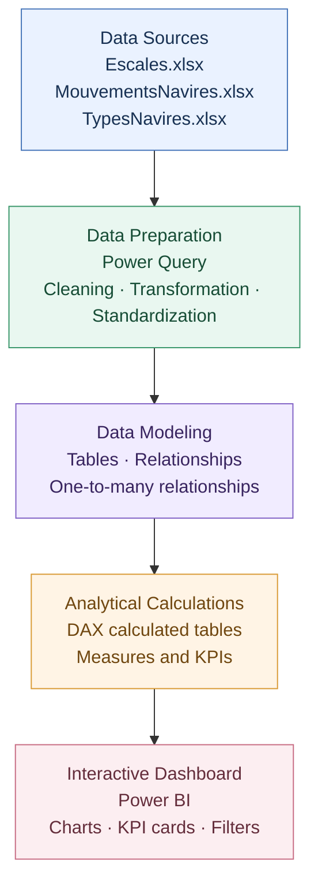

# Port Operations Analytics Dashboard

**Business Intelligence · Data Analytics · Microsoft Power BI**

An interactive dashboard developed during my internship at **Marsa Maroc – Port of Nador**, from June 15 to July 15, 2025. The project focuses on analyzing vessel stays and port operations through data preparation, modeling, and visualization using Power BI.

## Project Overview

The objective was to transform operational port data into meaningful indicators that can help monitor and analyze port activity.

The analysis focuses on:
- Vessel stays and port calls.
- Stay duration and berth occupancy.
- Port activity across different periods.
- Distribution of stays by berth and vessel type.

## Project Architecture

The project follows a data analysis workflow, from the original Excel files to the final Power BI dashboard.

### 1. Data Sources

The project uses three Excel files provided by the company:

- `Escales.xlsx` — information about port calls and vessels.
- `MouvementsNavires.xlsx` — vessel movements, arrival and departure dates and times, and berth codes.
- `TypesNavires.xlsx` — vessel type classifications.

### 2. Data Preparation — Power Query

The source data was cleaned and transformed before analysis. The main operations included:

- Harmonizing date and time formats.
- Removing duplicates and handling missing values.
- Standardizing vessel designations.
- Creating additional columns such as combined start date and time, stay duration, year, month, and day.

### 3. Data Modeling — Power BI

A relational data model was designed to organize the information and support analysis.

Several analytical tables were created using DAX, including:

- `Séjours` — central table containing vessel stay information and calculated durations.
- `DuréeTotaleParCodePoste` — aggregated stay durations and annual occupancy rates by berth.
- `TableResumé` and `TypesAvecDesignations` — tables used to organize vessel classifications and support filtering.
- `Table_Moyenne_Groupe` — average stay duration analysis by vessel group.

The model uses manually configured one-to-many relationships between tables.

### 4. Measures and KPIs — DAX

DAX measures were developed to calculate indicators such as:

- Average vessel stay duration.
- Annual berth occupancy rate.
- Number of stays and port calls.
- Maximum stay duration by vessel type.
- Time-based indicators for chronological analysis.

These measures respond dynamically to the filters selected in the dashboard.

## Dashboard Preview

The dashboard brings together the main indicators and visualizations in one interactive report.

**Main features:**
- KPI cards for key operational indicators.
- Monthly and yearly activity analysis.
- Stay duration and berth usage analysis.
- Vessel distribution by designation and group.
- Dynamic filters by year, berth, vessel group, and type.

## Data Model

The following screenshot shows the relational model designed in Power BI.

## Tools & Technologies

| Tool | Purpose |
|---|---|
| Microsoft Power BI | Data modeling and dashboard development |
| Power Query | Data cleaning and transformation |
| DAX | Calculated tables, measures, and KPIs |
| Microsoft Excel | Source data |

