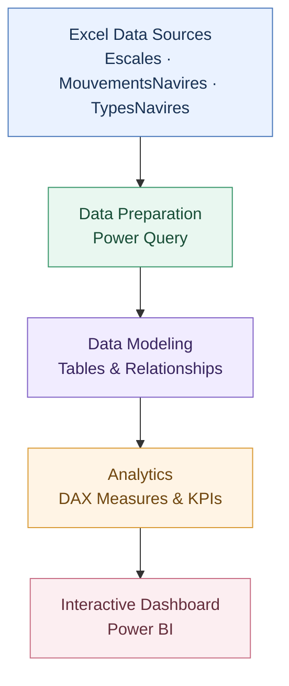

# Port Operations Analytics Dashboard

**Power BI · Data Analytics · Business Intelligence**

An interactive Power BI dashboard developed during my internship at **Marsa Maroc – Port of Nador** (15 June to 15 July, 2025) to analyze vessel stays, port calls, berth occupancy, and port activity.

## Architecture

The project follows a data analysis workflow, from raw Excel files to an interactive dashboard.

## Dashboard Preview

**Key insights and features:**
- Vessel stays and port calls.
- Average stay duration and berth occupancy.
- Activity analysis by month and year.
- Vessel distribution by type and designation.
- Interactive filters for dynamic exploration.

## Data Model

## Tools & Technologies

`Power BI` · `Power Query` · `DAX` · `Microsoft Excel`

